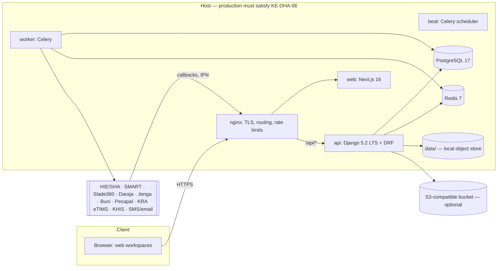
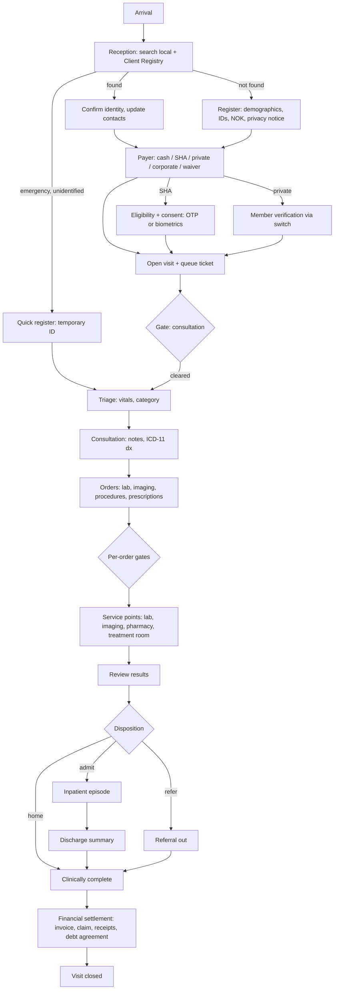
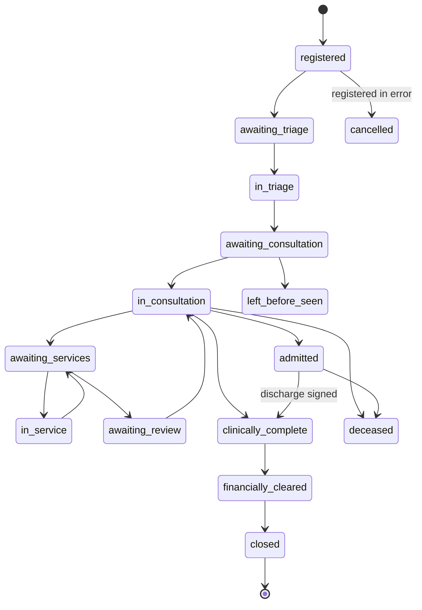

# AfyaSync HMIS — Design

This is the target design for the rework. Read the section for the area you are touching; you don't need the whole file every session.

Precedence when sources disagree: a regulator's current published spec → `docs/compliance/KENYA-REGULATORY-REGISTER.md` → this file → legacy code. When you deviate from this file, add an ADR to `docs/agent/DECISIONS.md` in the same commit.

| § | Topic | § | Topic |
|---|---|---|---|
| 1 | Scope | 11 | Insurance (summary) |
| 2 | Constraints that shape the design | 12 | Reporting |
| 3 | Architecture | 13 | Documents and storage (summary) |
| 4 | Module map | 14 | Notifications |
| 5 | Identifiers | 15 | Interoperability |
| 6 | Patient journey, reception to completion | 16 | Non-functional requirements |
| 7 | User access control (UAC) | 17 | API conventions |
| 8 | Data protection and records | 18 | Frontend architecture |
| 9 | Terminology and coding | 19 | Legacy migration |
| 10 | Billing, payments (summary) | 20 | Open questions for the owner |

---

## 1. Scope

**Users.** Kenyan facilities at KEPH levels 2–5 (dispensaries and medical centres up to county referral and private hospitals), run by one organisation with one or more facilities. Each existing `warehouses.Branch` can be a facility.

**In scope (v1).** Registration and identity; OPD; emergency; inpatient wards; basic maternity (ANC visit and delivery record); laboratory; imaging orders and reports; pharmacy and stores; procedures/treatment room; referrals; appointments; billing; payments (cash, M-Pesa, two banks, cards); insurance (SHA plus at least two private switches); MOH/KHIS reporting; UAC, audit and data protection; DHA certification evidence.

**Out of scope (v1) — leave extension points, don't build.** Theatre scheduling detail; PACS/DICOM viewer; analyser drivers (LIS); blood bank; dialysis machine integration; HR and payroll; general ledger (export journals instead); patient portal and mobile app; telemedicine; dental and eye charting.

**Success.** A facility can run a full day of OPD, emergency and inpatient work on it; the SHA UAT checklist passes end to end; the DHA certification evidence pack is complete; every acceptance scenario in `COMPLETION.md` passes.

## 2. Constraints that shape the design

| Constraint (register ID) | Design consequence |
|---|---|
| DHA-certified HMIS + HIE integration required for SHA contracting (KE-DHA-01, KE-DHA-03, KE-SHA-01) | HIE adapter is first-class; registry IDs (CR, FID, PUID) are stored fields; certification evidence is produced by the system and the test suite. |
| ICD-11 mandatory on SHA claims (KE-SHA-02) | ICD-11 is the primary diagnosis code system. ICD-10 appears only as a mapping where a report needs it. |
| Health data is sensitive; DPIA, ODPC registration, 72-hour breach notice (KE-DPA-*) | Privacy by design: default-deny authz, care-team access, audit of reads, field encryption, breach workflow. |
| Localisation and 20-year retention (KE-DHA-05, KE-DHA-06) | Storage abstraction with residency guard; retention engine; append-only clinical and financial records. |
| Emergency care cannot be refused; no detention over bills (KE-HLT-01, KE-HLT-02) | Payment gates never apply to emergencies; discharge never waits on payment. Both are encoded as tests. |
| Unreliable connectivity | External calls are async with retries where possible; the clinic keeps working when SHA, a bank or M-Pesa is down. |
| Shared workstations, busy staff, mixed screen quality | Fast re-authentication, keyboard-first workflows, high-contrast light UI (DESIGN-SYSTEM.md). |
| Payments are mostly M-Pesa and cash; insurers reach providers through switches | Payment and payer *ports* with swappable adapters; reconciliation is part of the product. |

## 3. Architecture



Properties:
- **Modular monolith.** Django apps are bounded contexts. An app changes another app's data only by calling that app's `services.py`. Reads across apps go through `selectors.py`.
- **Transactional outbox.** Domain events (`ChargeCaptured`, `VisitClosed`, `ClaimReady`, `PaymentSucceeded`…) are written to `core.Outbox` in the same transaction as the state change; the worker relays them to consumers. Consumers are idempotent (unique event ID).
- **Synchronous external calls** only where the user needs the answer to continue: eligibility, sending an OTP, starting an STK push, opening an SHA visit. Everything else (claim submission, status polling, eTIMS, KHIS export, SMS) is async.
- **Integration modes** per integration: `fake` (in-process fakes, default in dev and CI), `sandbox` (vendor test environments, staging), `live` (production). Env vars: `SHA_MODE`, `MPESA_MODE`, `JENGA_MODE`, `BUNI_MODE`, `PESAPAL_MODE`, `SMART_MODE`, `SLADE_MODE`, `ETIMS_MODE`, `KHIS_MODE`, `SMS_MODE`.
- **Environments.** dev (docker compose, fakes, synthetic data), staging (sandboxes, synthetic data — Contabo is fine here), production (live, real PHI — hosting must satisfy KE-DHA-06; see ADR-006).

## 4. Module map (`api/apps/`)

| App | Responsibility | Key models | Origin |
|---|---|---|---|
| `core` | Base models, money, gap-free sequences, outbox, configuration registry, feature flags | `BaseModel`, `PhiModel`, `Sequence`, `Outbox`, `Configuration` | legacy `core`, extended; legacy `AuditLog` frozen read-only |
| `accounts` | Users, staff profiles, professional licences, MFA devices, workstation sessions | `User`, `WorkerProfile` (staff profile), `ProfessionalLicence`, `MfaDevice`, `WorkstationSession` | legacy, extended — never rename (owns `AUTH_USER_MODEL`) |
| `access` | Permission catalogue, roles, scoped assignments, care teams, break-glass, maker-checker approvals | `Permission`, `Role`, `RoleAssignment`, `CareTeamMember`, `BreakGlassGrant`, `ApprovalRequest` | new |
| `audit` | Append-only, hash-chained audit events; verifier; viewer | `AuditEvent`, `AuditAnchor` | new |
| `facilities` | Facility registry data; departments; service points; wards; rooms; beds | `Facility` (1:1 `warehouses.Branch`), `Department`, `ServicePoint`, `Ward`, `Bed` | new |
| `patients` | Patient registry, identifiers, contacts, next of kin, consents, merges, DSARs | `Patient`, `PatientIdentifier`, `Contact`, `NextOfKin`, `Consent`, `PatientMerge`, `DataSubjectRequest` | new |
| `visits` | Visits, encounters, queues, payment-gate policies, appointments | `Visit`, `Encounter`, `QueueTicket`, `GatePolicy`, `GateOverride`, `Appointment` | new |
| `clinical` | Triage, vitals, notes (versioned), allergies, problems, diagnoses, alerts, ADRs | `TriageAssessment`, `VitalSigns`, `ClinicalNote`, `ClinicalNoteVersion`, `Allergy`, `Problem`, `Diagnosis`, `ClinicalAlert`, `AdverseReaction` | new |
| `orders` | Service requests (lab, imaging, procedure), order sets | `ServiceRequest`, `OrderSet` | new |
| `laboratory` | Specimens, results, validation, reference ranges | `Specimen`, `LabResult`, `ResultValidation`, `ReferenceRange` | new |
| `imaging` | Imaging studies and reports | `ImagingStudy`, `ImagingReport` | new |
| `pharmacy` | Prescriptions, verification, dispensing, MAR, controlled-drug register | `Prescription`, `PrescriptionItem`, `Dispense`, `MedicationAdministration`, `ControlledDrugEntry` | new |
| `inpatient` | Admissions, bed assignments, transfers, ward rounds, discharge | `Admission`, `BedAssignment`, `Transfer`, `DischargeSummary` | new |
| `referrals` | Referrals in and out | `Referral` | new |
| `terminology` | ICD-11, SHA interventions, MOH 705 mappings, drug and lab concepts | `CodeSystemVersion`, `Concept`, `ConceptMap` | new |
| `billing` | Service catalogue, price lists, charges, invoices, credit notes, waivers, debts | `Service`, `PriceList`, `PriceListItem`, `Charge`, `Invoice`, `InvoiceLine`, `CreditNote`, `Waiver`, `DebtAgreement` | new |
| `payments` | Payment intents, payments, allocations, receipts, refunds, cashier shifts, provider transactions, reconciliation | `PaymentIntent`, `Payment`, `Allocation`, `Receipt`, `Refund`, `CashierShift`, `ProviderTransaction`, `ReconciliationRun` | new; legacy M-Pesa code moves here |
| `insurance` | Payers, schemes, coverage, eligibility, payer consent, preauths, claims, remittances | `Payer`, `Scheme`, `Coverage`, `EligibilityCheck`, `PayerConsent`, `PreAuthorization`, `Claim`, `ClaimLine`, `ClaimAttachment`, `ClaimSubmission`, `Remittance` | new |
| `interop` | FHIR R4 mapping layer, HIE registry client, SHR export | mappers only | new |
| `integrations` | Exchange log, webhook inbox, shared HTTP client, SMS/email | `ExchangeLog`, `WebhookInbox`, `Notification` | legacy, extended |
| `documents` | Storage abstraction, documents, generated PDFs | `Document` | new |
| `reporting` | MOH registers and summaries, KHIS export, operational and financial reports | `ReportRun`, `DhisMapping` | legacy `analytics`, extended |
| `products`, `warehouses`, `suppliers`, `procurement`, `sales` | Inventory, stores, procurement; `sales` kept for over-the-counter retail at the pharmacy | + `StockBatch`, `UnitOfMeasure`, `Requisition`, `StockTake` | legacy, extended |

## 5. Identifiers

| Entity | Identifiers | Rules |
|---|---|---|
| Patient | Local MRN; HIE Client Registry ID (`CR…`); SHA number; national ID / Maisha Namba; alien ID; refugee ID; passport; birth certificate; birth notification; temporary ID (unidentified) | Stored as `PatientIdentifier(type, value_encrypted, value_blind_index, issuer, verified_at, source)`. Search uses the blind index (HMAC). MRN format configurable per facility, default `{MFL}-{YY}-{seq:06d}`, gap-free. |
| Visit | Human number `{OP|EM|IP}-{MFL}-{YYMMDD}-{seq}`; UUIDv7 internally | Never expose sequential IDs in URLs. |
| Facility | KMHFL MFL code; Facility Registry FID (`FID-…`); SHA contract number; KEPH level; KRA PIN; Slade provider code; ODPC registration number | All on `Facility`. |
| Practitioner | Regulator (KMPDC, COC, NCK, PPB, KMLTTB…) + registration number; HWR PUID (`PUID-…`); national ID (encrypted); Slade code | On `ProfessionalLicence` / `WorkerProfile`. |
| Money documents | Invoice, receipt, credit note numbers | Gap-free per facility per year via `core.sequences` (row lock). |

## 6. Patient journey — reception to completion

### 6.1 End-to-end flow



### 6.2 Visit state machine



Rules:
- Transitions live in `visits.services` and are the only way to change `Visit.status`; each transition is audited with actor and timestamp.
- Emergency visits start at `in_triage` (or skip triage when the triage nurse is the treating team) and never stop at a gate.
- `left_before_seen`: a ticket called N times (default 3) or idle for a configurable period moves the visit to a work queue; staff confirm. Charges for services not rendered are reversed.
- `clinically_complete` requires: at least one final ICD-11 diagnosis; every order resulted or cancelled with reason; every prescription item dispensed, marked "external", or declined with reason; disposition recorded; notes signed (and co-signed where the author is an intern).
- `financially_cleared` requires: final invoice(s) issued; each patient-responsibility invoice paid **or** covered by a debt agreement; each payer invoice has a claim submitted **or** queued with a known reason. Physical departure never waits for this state.
- `closed` requires both plus generated documents (receipt(s), visit or discharge summary). OPD visits not closed within 24 hours appear in the records officer's work queue.

### 6.3 Service points and queues

- A `ServicePoint` (triage, consultation room 1, lab reception, pharmacy window, cashier 2…) owns a queue. `QueueTicket` numbers are per service point per day (`T-014`).
- Ordering: triage category first (red → orange → yellow → green), then arrival time; manual "priority" (elderly, disabled, pregnant, VIP) is a reason-coded bump, audited.
- Actions: call next, recall, skip (no-show), transfer to another service point, send back with a note.
- Queue display boards (TV) show ticket number and service point only — no names.

### 6.4 Payment gates

A gate is a policy evaluated before a service starts. `GatePolicy(facility, service_point_type, visit_type, payer_type) → gate`. Gate types: `none`, `pay_before_service`, `eligibility_verified`, `member_verified`, `preauth_approved`, `deposit`, `credit_limit`.

Defaults (seeded, editable by facility admin with maker-checker):

| Context | Cash | SHA | Private insurer | Corporate | Waiver |
|---|---|---|---|---|---|
| Any emergency service | none | none | none | none | none |
| OPD consultation | pay_before_service | eligibility_verified | member_verified | credit_limit | none |
| Lab / imaging / procedure | pay_before_service | preauth_approved *if intervention flags it*, else none | preauth_approved *if scheme requires*, else none | credit_limit | none |
| Pharmacy | pay_before_service | none for covered items; uncovered items → patient pays | per scheme rules | credit_limit | none |
| Elective admission | deposit (configurable) | eligibility_verified + preauth where flagged | preauth_approved | credit_limit | none |
| Discharge | **never gated** | **never gated** | **never gated** | **never gated** | **never gated** |

Overrides: `visits.gate.override` (default: medical superintendent, nurse in charge) with a reason code; audited; visible on the bill.

### 6.5 Inpatient episode

Admission request (clinician) → bed allocation (admissions or nurse in charge) → admitted → ward rounds, nursing kardex, MAR, observations, intake/output → daily bed and nursing charges (scheduled job at midnight, idempotent per bed-day) → transfers between wards/beds → discharge planning → discharge summary signed → clinical discharge → final invoice and claim dispatch → bed released (status `cleaning` → `available`).

Discharge reasons match SHA's enum: `recovered`, `referred`, `deceased`, `absconded`, `other`. For SHA inpatient visits, discharge triggers the SHA discharge flow (discharge OTP or biometrics → `POST /claims/discharge`, Phase 3).

### 6.6 Emergency

- Arrival mode (walk-in, ambulance, other) and "brought by" (relative, samaritan, paramedics, unknown) — the same vocabularies SHA uses for emergency claims.
- Quick registration with minimum fields; unidentified patients get a temporary ID and a placeholder name ("Unknown male, approx. 30y, ER-0917"). Merge into the real record later through `PatientMerge` (maker-checker, audited).
- Triage immediately; red/orange go straight to resuscitation/treatment. No payment, deposit or eligibility gate at any point of the emergency episode.
- Phase 3: ECCIF emergency claim opened at presentation (identified or unidentified); a 24-hour submission timer with escalating alerts.

### 6.7 Referrals, follow-up, death

- Referral out: reason, urgency, receiving facility (FID/MFL), clinical summary, transport; referral letter PDF; tracking and feedback. Referral in: link to the incoming letter and the referring facility.
- Follow-up: appointment created at discharge or consultation end; SMS reminder without clinical detail.
- Death: time, ICD-11 cause(s), certifying clinician; death notification document; disposition to mortuary; all open orders cancelled; billing proceeds normally; bodies are never held over bills (KE-HLT-02).

## 7. User access control (UAC)

### 7.1 Principles
Default deny. Least privilege. Need to know (care relationship). Separation of duties. Accountability (every PHI read and every write is audited). Emergency access through break-glass, never by sharing accounts.

### 7.2 Authentication
- Django session in an httpOnly, Secure, SameSite=Lax cookie; CSRF on unsafe methods. The browser talks to `/api` on the same origin (see §18). No bearer tokens in the browser.
- Passwords: argon2id; minimum 12 characters; check against a bundled breached-password list; no forced periodic rotation; change on suspicion.
- MFA: TOTP with recovery codes. **Required** for facility admin, system admin, medical superintendent, finance manager, claims officer, auditor, DPO, and for any login from outside the facility network allowlist. Facility setting can require it for everyone. WebAuthn is a later extension.
- Lockout: progressive delay after 5 failures, lock after 10 (admin unlock), all audited.
- Timeouts: workstation lock after 5 minutes idle (PIN re-auth); session idle expiry 30 minutes; absolute 12 hours. All configurable per facility within bounds.
- Shared workstations: "lock and switch user" keeps the device session; the next user unlocks with their own PIN if they signed in on that workstation within the last 12 hours, otherwise with password (+ MFA where required). PINs are per user, 6 digits, hashed and rate-limited. Every action carries the real user.
- Service accounts (integrations, public API): hashed API keys, scoped permissions, IP allowlist, rate limits; no PHI scopes unless an ADR approves.

### 7.3 Authorization decision

```
allow(user, permission, resource) =
    has_permission(user, permission, scope_of(resource))      # RBAC within facility/department/ward scope
  ∧ licence_ok(user, permission)                               # clinical permissions need an active licence
  ∧ relationship_ok(user, resource)                            # PHI: care team, current queue, or break-glass
  ∧ sensitivity_ok(user, resource)                             # sensitive categories need an extra permission
  ∧ sod_ok(user, permission, resource)                         # cannot approve own request, etc.
```

Implement once in `access.policies`; views declare a permission code; selectors apply object scoping. The UI receives the user's effective permissions from `GET /api/v1/me` only to hide controls.

### 7.4 Roles (seeded; facilities can clone and adjust)

| Role | Purpose | Notable permissions (non-exhaustive) | Chart access |
|---|---|---|---|
| System administrator | Technical configuration, integrations | `admin.config.*`, `integrations.*.configure` | none (break-glass only) |
| Facility administrator | Users, roles, assignments within facility | `admin.user.*`, `access.assignment.manage`, `access.assignment.grant_privileged` (needs second approver) | none |
| Medical superintendent | Clinical oversight, approvals, break-glass review | `clinical.record.read_full` (facility scope), `visits.gate.override`, `billing.waiver.approve_high`, `access.breakglass.review` | full + sensitive |
| Health records officer (HRIO) | Registration quality, merges, MOH reporting, record release | `patients.*`, `patients.merge.request`, `reporting.moh.*`, `patients.dsar.process` | demographics + summary |
| Receptionist | Registration, visits, queues, eligibility | `patients.patient.create/update`, `visits.visit.create`, `insurance.eligibility.check`, `insurance.consent.request` | demographics |
| Triage nurse | Vitals and triage | `clinical.vitals.record`, `clinical.triage.record` | summary + current visit |
| Nurse | Nursing notes, MAR, procedures, ward care | `clinical.nursing_note.write`, `pharmacy.mar.record`, `orders.procedure.perform` | full (care team) |
| Clinical officer | Consultation, diagnosis, orders, prescribing | `clinical.note.write`, `clinical.diagnosis.write`, `orders.*.create`, `pharmacy.prescription.create`, `referrals.create` | full (care team) |
| Medical officer | As clinical officer, plus admission and discharge | + `inpatient.admission.create`, `inpatient.discharge.sign` | full (care team) |
| Specialist / consultant | As medical officer, specialist procedures, clinical preauth sign-off | + `insurance.preauth.clinical_signoff` | full (care team) |
| Intern (any cadre) | Supervised practice | as cadre, but notes and prescriptions need `clinical.cosign` by a supervisor | full (care team) |
| Lab technologist / Lab supervisor | Specimens and results / validation and release | `laboratory.result.enter` / `laboratory.result.validate`, `laboratory.result.release` | orders + relevant history |
| Radiographer / Radiologist | Perform study / report | `imaging.study.perform` / `imaging.report.sign` | orders + relevant history |
| Pharmacist / Pharmaceutical technologist | Verify and dispense / dispense | `pharmacy.prescription.verify`, `pharmacy.dispense`, `pharmacy.controlled.dispense` (pharmacist only) | medication-relevant summary |
| Cashier | Receive payments, receipts, own shift | `payments.receive.*`, `payments.shift.own` | demographics + bill |
| Billing officer | Charges, invoices, adjustments | `billing.charge.adjust_request`, `billing.invoice.finalize` | demographics + bill |
| Claims officer | Eligibility, preauths, claims, rejections | `insurance.*` except clinical sign-off | claim-relevant documents only |
| Finance manager | Approvals, reconciliation, write-offs | `payments.refund.approve`, `billing.waiver.approve`, `billing.writeoff.approve`, `payments.reconciliation.signoff` | none |
| Store keeper / procurement | Inventory, requisitions, purchasing | existing inventory permissions + `inventory.batch.*` | none |
| Data protection officer | DSARs, consents, breach log, audit review | `audit.log.read`, `patients.dsar.*`, `privacy.breach.*` | via DSAR process only |
| Auditor (internal/external) | Read-only audit of finance and access | `audit.log.read`, `reports.financial.read` | none (break-glass if a case needs it) |
| Report viewer | Aggregated, de-identified reports | `reports.aggregate.read` | none |

**Supervisor add-on roles** carry the approval permissions for one area and are assigned on top of a base role: cashier supervisor (`payments.shift.supervise`, `payments.void.approve`), billing supervisor (`billing.waiver.approve_low`), claims supervisor (`insurance.claim.cancel_submitted`), HRIO supervisor (`patients.merge.approve`), nurse in charge (`visits.gate.override`, ward allocation), pharmacy in-charge (`pharmacy.stock_adjustment.approve`). The maker-checker table in §7.9 refers to these.

### 7.5 Permission catalogue
- Code-defined in `apps/<app>/permissions.py` as `PermissionDef(code, description, sensitivity, requires_licence, privileged)`. A management command syncs them to the DB; CI fails when a view references an unknown code.
- Naming: `<domain>.<resource>.<action>`, lowercase, actions are verbs (`create`, `read_full`, `validate`, `approve`).
- `make role-matrix` writes `docs/generated/role-matrix.csv`; the policy test suite asserts every cell.

### 7.6 Scope and validity
`RoleAssignment(user, role, facility, department?, ward?, valid_from, valid_to, granted_by, approved_by)`. Locums and students get time-bound assignments. Privileged roles (marked on the role) need a second facility admin to approve (`ApprovalRequest`). Users are deactivated, never deleted; deactivation revokes sessions immediately.

### 7.7 Chart access levels and care teams

| Level | What it shows | Who gets it by default |
|---|---|---|
| none | — | system admin, finance, store |
| demographics | name, identifiers, contacts, payer, visit list | reception, cashier, billing |
| summary | demographics + allergies, alerts, active problems, active medications, current visit status | triage, pharmacy, HRIO, any clinician not on the care team |
| full | entire record except sensitive categories | care team members |
| sensitive | full + sensitive categories | care team members with `clinical.record.read_sensitive` |

A user is on the care team when assigned to the current visit or admission (consultation, nurse allocation, ward assignment, order performer) or when the patient is in a queue at the user's service point. Care-team membership expires 72 hours after the visit or admission closes (configurable).

**Sensitive categories** (flag on note/diagnosis/result/document): HIV and PrEP, mental health, sexual and reproductive health, gender-based violence and post-rape care, substance use, genetic results. Hidden from users without the permission, from claims attachments unless the payer requires them, and from printed visit summaries unless explicitly included.

### 7.8 Break-glass
A clinician without full access can request it with a reason (`emergency`, `continuity of care`, `clinical review`, free text required). Access is granted immediately for 60 minutes (configurable), labelled on screen, logged at high severity, and notifies the medical superintendent and DPO. Every break-glass grant enters a review queue; reviewers mark it justified or escalate. Break-glass never grants sensitive categories unless the user also holds that permission.

### 7.9 Separation of duties (maker-checker)
A generic `ApprovalRequest` (requester, action, payload hash, approver role, threshold, status, expiry). The requester can never approve their own request.

| Action | Approver |
|---|---|
| Refund (any method) | finance manager |
| Waiver: up to threshold A / above A / above B | billing supervisor / finance manager / finance manager + medical superintendent |
| Write-off of patient debt | finance manager |
| Price list change, new service | finance manager |
| Privileged role grant | second facility admin |
| Patient merge / unmerge | HRIO supervisor |
| Allocation from suspense account | finance manager |
| Controlled-drug stock adjustment | second pharmacist or in-charge |
| Cancelling a submitted claim | claims supervisor |
| Amending a signed discharge summary | author + medical superintendent co-sign |

### 7.10 Licence gating
`ProfessionalLicence(user, regulator, registration_number, licence_number, valid_to, puid, verified_at, verification_source)`. Clinical permissions marked `requires_licence` are denied when the licence is missing or expired. A nightly job warns 30 days before expiry. The HIE practitioner search (Phase 3) verifies registration and stores the PUID.

### 7.11 Audit
- `AuditEvent(id, ts, actor_id, actor_role, facility_id, workstation_id, ip, user_agent, request_id, action, resource_type, resource_id, patient_id, purpose, outcome, detail_json, prev_hash, hash)`.
- Writes are recorded by services; PHI reads by `ChartAccessMiddleware` plus explicit calls in selectors returning PHI (chart open, document view, search result sets — search terms are stored as HMAC, never plain).
- Hash chain per facility per day; a daily `AuditAnchor` stores the last hash, also written to a separate append-only file under `data/audit-anchors/` (and backups). `manage.py audit_verify --from --to` detects tampering.
- Retention 20 years (KE-DHA-05). No UI or API can update or delete audit rows; the DB role used by the app has no UPDATE/DELETE grant on the audit table (migration sets grants in production).
- Viewers: DPO and auditor (filters by user, patient, action, date); every user can see "who accessed my record" only through a DSAR (v1).

### 7.12 Access reviews
Quarterly report per facility: users, roles, last login, break-glass counts, dormant accounts (>60 days) flagged for deactivation.

## 8. Data protection and records

### 8.1 Classification

| Class | Examples | Controls |
|---|---|---|
| Secret | API keys, signing keys, field-encryption keys, consent tokens | env/secret store only; encrypted at rest; never logged |
| Sensitive PHI | sensitive-category clinical data | sensitive permission + care team; excluded by default from exports |
| PHI | clinical records, identifiers, contacts, claims | authz + audit; field encryption for identifiers and contacts |
| Confidential | financial records, staff data | role-based |
| Internal | catalogues, price lists, configuration | role-based |
| Public | facility name, opening hours | none |

### 8.2 Encryption
- In transit: TLS 1.2+ everywhere, including internal calls between hosts.
- Field level: identifiers, phone numbers, emails, next-of-kin contacts, consent tokens, raw integration payloads — AES-256-GCM with key IDs (`FIELD_ENCRYPTION_KEYS` JSON of `{kid: base64key}`, newest first); blind index (HMAC-SHA256 with a separate key) for exact-match search; `manage.py rotate_field_keys` re-encrypts in batches.
- Documents: envelope encryption (§13). Backups: encrypted before leaving the host (age or rclone crypt).

### 8.3 Residency guard
`DATA_RESIDENCY_MODE = strict | warn | off` (production default `strict`). In `strict`, the API refuses to start if any PHI-bearing endpoint (S3 storage, backup target, error tracker, log shipper) is not in `RESIDENCY_ALLOWED_HOSTS`. In `warn`, it starts, logs a warning at boot and shows an admin banner. Adding a non-Kenyan host to the allowlist requires an ADR referencing the legal basis (KE-DHA-06, KE-DPA-07).

### 8.4 Retention
| Record | Retention | Notes |
|---|---|---|
| Clinical records, documents, audit events | ≥ 20 years after last encounter | KE-DHA-05; legal hold overrides |
| Financial records (invoices, receipts, claims) | ≥ 20 years when linked to clinical care, else ≥ 7 years | tax law floor is shorter; keep with the clinical record |
| Integration payloads (`ExchangeLog`) | 2 years, or with the claim/payment they support | configurable |
| Notification bodies | 1 year | delivery metadata kept longer |
| Sessions, rate-limit data | 90 days | |
No hard deletes of clinical or financial rows. Purges (after retention) run as a reviewed batch job with a report.

### 8.5 Consent
- Privacy notice acknowledgement at registration (who processes data, why, ODPC registration numbers, rights, contact for DPO) — `Consent(type=privacy_notice, version, captured_by, method)`.
- Procedure/treatment consent forms as signed documents (scanned or e-signature capture).
- SMS reminders opt-in; marketing never on by default; research opt-in off.
- SHA consent (OTP/biometrics) is a *payer authorisation* stored in `insurance.PayerConsent`, not a privacy consent.

### 8.6 Data subject requests
`DataSubjectRequest(type: access|correction|deletion|objection|portability, received_at, identity_verified_by, due_at, status, response_document)`. Access/portability produce a FHIR bundle (JSON) plus a readable PDF summary. Corrections go through clinical amendment (never silent edits). Deletion requests are answered with the legal basis when retention law applies. Track the statutory deadline in `due_at` (confirm current ODPC timelines; record in DECISIONS.md).

### 8.7 Breach response
`PrivacyIncident` with detection source, affected records count, risk assessment, containment steps, `awareness_at`, ODPC notification deadline (`awareness_at + 72h`), notification sent at, subjects notified. Dashboard shows the countdown. Templates live in `docs/operations/BREACH-RESPONSE.md` (written in Phase 3).

### 8.8 De-identification
Statutory MOH reports are aggregate by design. Other exports (research, analytics, AI) are off by default; if enabled later: drop direct identifiers, generalise dates to month, suppress counts below 5, record an ADR and DPIA reference.

### 8.9 AI features
The legacy `ai` endpoints are disabled behind `AI_FEATURES_ENABLED=false` until a DPIA covers them. No PHI is sent to external LLM or AI APIs (KE-DPA-07, KE-DHA-06). If an AI feature is approved later, it runs on de-identified input or on infrastructure in Kenya, and every call is audited.

## 9. Terminology and coding

| Domain | Standard | Implementation |
|---|---|---|
| Diagnoses | ICD-11 MMS (WHO release, versioned) | Load the WHO release into `terminology` (code, title, parent, chapter, synonyms). Search with Postgres trigram + unaccent; only valid leaf/acceptable codes selectable. Optional sync with DHA terminology service (OCL, ilm-hie.dha.go.ke). |
| SHA interventions and tariffs | SHA Benefits and Tariffs spreadsheet | Versioned import (`manage.py import_sha_tariffs <file> --version`); fields: code, name, package, sub-benefit, access point, payment mechanism, preauth flags, tariff by KEPH level, fund. Map to local `Service`s. |
| MOH 705A/705B categories | MOH condition lists | `ConceptMap` ICD-11 → 705 category, seeded as a draft flagged "needs HRIO review"; editable by HRIO; unmapped codes surface in a report. |
| Medicines | Local catalogue → DHA product/generic concept codes when available; KEML flag; PPB registration number | Fields on `products.Product` for drugs: generic name, strength, form, route, ATC (optional), DHA concept code, controlled schedule. |
| Lab tests | Local catalogue; LOINC optional | Reference ranges by sex and age band; UCUM units. |
| Vitals | UCUM | °C, mmHg, /min, %, kg, cm, mmol/L, MUAC cm. |

## 10. Billing and payments (summary)

**Service catalogue.** `Service(code, name, department, kind: consultation|lab|imaging|procedure|bed_day|nursing|drug_dispense|package|other, revenue_code, sha_interventions[], etims_item_code, active)`.

**Price resolution.** scheme-specific price → payer default price → facility cash price. Price lists are effective-dated; changes go through maker-checker.

**Charges.** Created from clinical events by `billing.services.capture_charge(event)` — idempotent on `(source_type, source_id, service)`. States: `provisional` (ordered) → `posted` (performed) → `invoiced` → `reversed`. Each charge carries a responsibility split: `payer_amount`, `patient_amount`, and a non-coverage reason (`excluded`, `limit_exceeded`, `no_preauth`, `copay`, `not_contracted`).

**Invoices.** One per responsible party per visit (patient, SHA, insurer X, employer). Interim invoices for inpatients; finalised invoices are immutable — corrections via credit notes. Numbering gap-free. PDF with facility details, KRA PIN and, when eTIMS is on, control number and QR.

**Deposits, waivers, debts.** Deposits are unallocated payments applied at final invoice. Waivers follow §7.9 thresholds. A remaining patient balance at discharge becomes a `DebtAgreement` (instalments, optional guarantor, statements by SMS/email). There is no state that holds a patient or body for payment (KE-HLT-02).

**Payments.** Detailed in `docs/integrations/PAYMENTS.md`; cash procedure in `docs/operations/CASH-HANDLING-SOP.md`. Payment methods: cash, M-Pesa (Daraja), Equity (Jenga), KCB (Buni), cards (Pesapal hosted checkout; PDQ capture), insurance remittances, deposits, credit notes.

## 11. Insurance (summary)

Detailed in `docs/integrations/INSURANCE.md`. Key points:
- Local `Claim` is the source of truth. A `PayerGateway` port translates it for each payer: SHA (HIE eClaims REST — primary; AfyaLink FHIR bundle — secondary, flag), SMART, Slade360, optional M-TIBA, and a "manual" payer that produces a claim pack.
- Eligibility and consent happen at reception; preauth before gated services; claims are scrubbed before dispatch (ICD-11, intervention mapping, three mandatory SHA documents, totals, preauth outstanding).
- Submission is exactly-once with an "outcome unknown" path that queries before retrying.

## 12. Reporting

| Report | Source | Output |
|---|---|---|
| OPD register (MOH 204A/B equivalent) | visits + diagnoses | screen, CSV, PDF |
| MOH 705A (<5) / 705B (≥5) monthly morbidity | final diagnoses mapped via `ConceptMap` | screen, CSV, DHIS2 dataValueSets JSON |
| MOH 717 service workload | visits, admissions, procedures, bed-days | same |
| MOH 706 laboratory | lab results | same |
| MOH 505 weekly IDSR | notifiable conditions list | same |
| Operational | queue times, LWBS rate, bed occupancy, turnaround times (lab, pharmacy) | dashboards |
| Financial | revenue by payer/service, collections by method, debts aging, claims aging, rejection reasons, cashier variances | dashboards + CSV |

DHIS2 element/category-option-combo UIDs live in `DhisMapping`, maintained by the HRIO from the county's KHIS configuration — never hard-coded. KHIS push is optional (`KHIS_MODE`); CSV export is always available.

## 13. Documents and storage (summary)

Detailed in `docs/integrations/STORAGE.md`. All files go through `documents.storage`: local backend at `<repo>/data` by default, S3-compatible backend (Contabo or any S3 endpoint) by env switch. Each `Document` row records which backend holds it, so both can be live at once and `storage_migrate` moves objects between them. Objects are envelope-encrypted, keyed by UUID (no PHI in keys), never public, and served only through an authorised, audited API stream.

## 14. Notifications

- Channels: SMS (Africa's Talking), email (SMTP). `NOTIFICATION_CHANNEL` default `email` (legacy behaviour kept); SMS enabled per template.
- Templates: appointment reminder, results ready (no values), receipt (amount, receipt number, facility), payment request link, debt statement, STK prompt fallback instructions.
- **No clinical details in SMS or email bodies.** Names limited to first name. Opt-out honoured for non-essential messages.
- Delivery tracking (`Notification.status`, provider message ID), retries with backoff, per-patient rate limits.

## 15. Interoperability

- `interop` maps internal models to FHIR R4 resources: Patient, Practitioner, Organization, Location, Encounter, EpisodeOfCare, Condition, Observation, AllergyIntolerance, ServiceRequest, DiagnosticReport, MedicationRequest, MedicationDispense, Procedure, Coverage, Claim, ClaimResponse, CoverageEligibilityRequest/Response, AuditEvent. Validate with `fhir.resources` (R4) and the Kenyan profiles once their packages are pinned.
- Uses: SHA FHIR bundle path (§11), SHR export, patient record export (DSAR/portability), future referral exchange.
- Registries: Client Registry lookup at reception (local first, then CR); Facility Registry (FID) on facility setup; Health Worker Registry (PUID) on licence verification.

## 16. Non-functional requirements

| Area | Target |
|---|---|
| Latency | p95 < 300 ms for reads, < 800 ms for writes (excluding external calls); patient search < 500 ms with 200k patients and 1M visits |
| Reception throughput | registering a returning patient and opening a visit: under 60 seconds, keyboard only |
| Availability | single-node v1 target 99.5% monthly; degraded mode when integrations fail |
| Degraded mode | HIE down → banner, eligibility marked `pending_verification`, claim calls queued; payment provider down → other methods offered; downtime procedure (paper forms + back-entry screen) documented |
| Backups | nightly encrypted `pg_dump` + `data/` sync, GFS rotation (7 daily, 4 weekly, 12 monthly); RPO 24 h (v1), RTO 4 h; monthly restore drill with a recorded result (certification evidence) |
| Observability | JSON logs with request ID and no PHI; error tracking with scrubbing; integration dashboard (success rate, latency, queue depth); health and readiness endpoints |
| Security | OWASP ASVS L2; CSP (strict, nonce-based), HSTS, `frame-ancestors 'none'`, `Referrer-Policy: no-referrer`; rate limits on login, search, OTP, payment initiation; outbound HTTP allowlist (SSRF guard); containers non-root; Postgres/Redis never published on public interfaces |
| Locale | `Africa/Nairobi`; en-KE; KES with 2 decimals; dates DD/MM/YYYY; phone E.164 `+254…`; i18n-ready for Swahili |

## 17. API conventions

- REST under `/api/v1/`; OpenAPI 3.1 via drf-spectacular, committed at `api/openapi.yaml`; CI fails on undocumented drift.
- Resources identified by UUIDv7; human numbers (MRN, visit number) are fields, not keys.
- Errors: RFC 9457 `application/problem+json` with `type`, `title`, `status`, `detail`, `code`, `request_id`, and `errors[]` for field validation. No PHI in error text.
- Pagination: cursor for patients, visits, audit, transactions; page-number for catalogues.
- Concurrency: `version` integer on mutable clinical/financial resources; `If-Match`-style `version` in the body; 409 on conflict.
- Idempotency: `Idempotency-Key` header required on payment initiation, refunds, claim submission and any POST that calls an external system; key + request hash + response stored 24 h.
- Money: decimal strings (`"1500.00"`), currency implied KES unless a field says otherwise.
- Time: ISO 8601 with offset; dates as `YYYY-MM-DD`.
- Webhooks/callbacks: `/api/v1/hooks/<provider>/<secret-path-token>/` — verify, persist raw (encrypted) to `WebhookInbox`, return 2xx quickly, process async.
- The legacy public API (`/api/v1/public/`, `X-API-Key`) stays for non-PHI data only; keys hashed, scoped and rate-limited.

## 18. Frontend architecture

- `web/` is a Next.js 16 App Router app (TypeScript strict). It replaces `frontend/` entirely.
- Same origin: the browser calls `/api/*`; in development `next.config` rewrites to Django, in production nginx routes `/api/` to Django and everything else to Next. Session cookie and CSRF work without CORS.
- Workspaces by role, each a route group with its own worklist: reception, triage, consult, lab, imaging, pharmacy, wards, cashier, billing, claims, inventory, reports, admin. A user with several roles switches workspace from the shell.
- Patient context: every patient-scoped screen shows the patient banner (two identifiers, age, sex, allergies, alerts, payer) and the journey rail (DESIGN-SYSTEM.md).
- Design system and component rules: `docs/agent/DESIGN-SYSTEM.md`. Frontend coding rules: `web/CLAUDE.md`.

## 19. Legacy migration

| Legacy | Decision |
|---|---|
| Django 4.2 (EOL 7 April 2026), Python 3.9 | Upgrade to Django 5.2 LTS (supported to April 2028), Python 3.12+ (ADR-002). |
| `root/` settings package | Move to `api/config/` with `settings/{base,dev,test,prod}.py` (ADR-003). |
| `accounts.User`, `WorkerProfile` | Keep; extend (licences, MFA, PIN). Don't rename the app. |
| `core.AuditLog` | Freeze read-only; new `audit` app takes over. |
| DRF `TokenAuthentication` for the web | Replace with session + CSRF; revoke legacy tokens at cutover. |
| `integrations` (M-Pesa, SMS, notifications) | M-Pesa client logic moves into `payments/adapters/mpesa`; notifications stay. |
| `sales` (retail orders, receipts) | Keep for over-the-counter pharmacy retail; payments move to `payments`. |
| `analytics` | Becomes `reporting` (keep existing models needed by dashboards; migrate gradually). |
| `frontend/` (static/React dashboards: `/admin`, `/facility`, `/reports`) | Port to Next.js using the parity checklist from `FRONTEND_AND_API_SPEC.md`; delete after parity (P1-WEB-06). |
| `ai` endpoints | Disabled by default (§8.9). |
| `db.sqlite3`, `*.log`, `.env` in the working tree | Untrack, ignore, and report any committed secrets for rotation (P1-REPO-02). Never rewrite history without the owner's approval. |
| `apps/reset.ps1` | Move to `scripts/dev/` if it is dev-only; delete if it can drop production data. |

## 20. Open questions for the owner

Record answers as ADRs. Until answered, use the stated default.

1. Production hosting for real patient data — Kenya-hosted (default assumption) or Contabo with a documented legal basis? (ADR-006)
2. Which private insurers will the first facility bill most? (default: through SMART and Slade360)
3. Card acquiring — Pesapal (default) or a bank acquirer's gateway?
4. Is this sold as a product to multiple facilities (vendor certification by DHA) or deployed for one hospital group? (default: product — certify)
5. Waiver thresholds A/B and deposit amounts (defaults: A = KES 5,000, B = KES 50,000; elective deposit = estimated bill × 50%).
6. Will eTIMS be done system-to-system (OSCU/VSCU) or through KRA's own tools at go-live? (default: adapter built, flag off)
